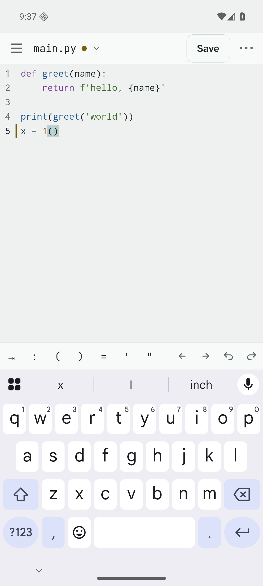
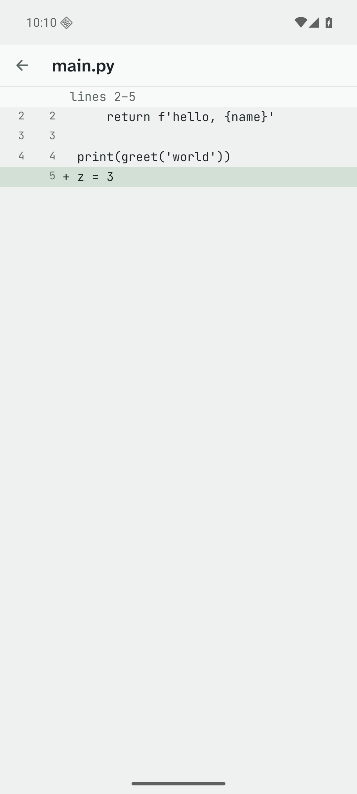
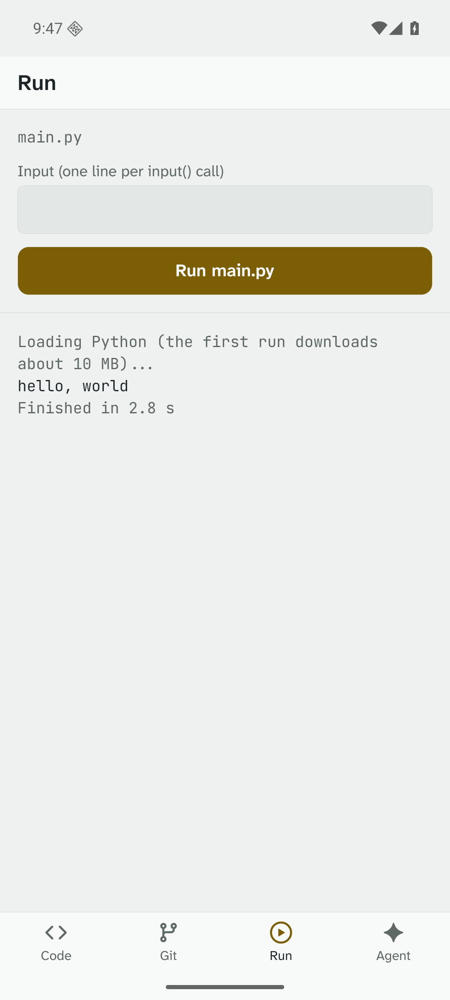
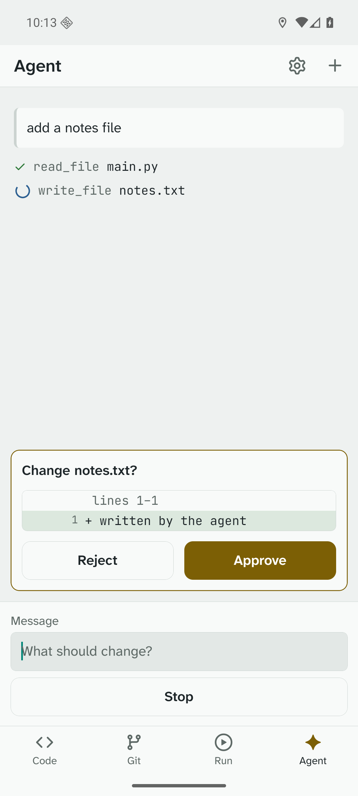

# TARKA

A code editor and small IDE for Android phones, built for typing code on a touch screen.
Edit files, use Git, run code and work with an AI agent, all on the phone.

<p>
  
  
  
  
</p>

## Install

Download the APK from the [latest release](https://github.com/akshajtiwari/tarka/releases/latest) on your phone
and open it. Android 7.0 or newer, 64-bit (arm64).

## Features

- **Editor:** CodeMirror 6 with highlighting for JavaScript, TypeScript, Python, HTML, CSS, JSON and Markdown.
  - A key row above the keyboard with symbols, arrows and undo; hold and slide it to move the cursor.
  - Suggestion chips that learn the words you pick.
  - Tabs (swipe the header to switch), autosave, find and replace, go to line, pinch to zoom, and read lock.
  - Ctrl+S on a hardware keyboard.
- **Files:** projects from templates or Git, an explorer drawer with file actions, quick open and search.
- **Git:** init, stage, commit and diff, plus history with commit details, branches, and clone, pull and push
  with a token.
- **Run:** JavaScript, TypeScript, Python (Pyodide) and HTML preview, on the phone, with Stop for endless loops.
- **Agent:** bring your own Claude or OpenAI-compatible key. Every write or delete waits for your approval.
- Dark and light themes, and a side rail on tablets.

## Build from source

The stack is Expo SDK 57 (React Native 0.86) and TypeScript, with CodeMirror 6 inside an Expo DOM component,
isomorphic-git, and zustand.

```bash
npm install
scripts/setup-android.sh   # JDK 17, Android SDK, emulator and Maestro, all in your home folder (no sudo)
scripts/emulator.sh        # start the emulator
npm run android            # build and install the dev app
npm start                  # Metro with hot reload
```

To run on a phone, plug it in and run `scripts/phone.sh`. Details are in [docs/DEV_SETUP.md](docs/DEV_SETUP.md).

## Tests

```bash
npm run check   # typecheck, lint and unit tests
npm run e2e     # Maestro UI flows on the emulator (local git and fake AI servers included)
```

See [docs/TESTING.md](docs/TESTING.md). Releases are built with `scripts/build-release.sh`,
as described in [docs/RELEASE.md](docs/RELEASE.md).

## Docs

- [docs/HANDOFF.md](docs/HANDOFF.md): start here when you pick up the project.
- [docs/ARCHITECTURE.md](docs/ARCHITECTURE.md): how the editor, Git, runner and agent fit together.
- [docs/ROADMAP.md](docs/ROADMAP.md): what's done and what's next.
- [docs/UI.md](docs/UI.md): design rules. [docs/COMPILERS.md](docs/COMPILERS.md): options for running more languages.
